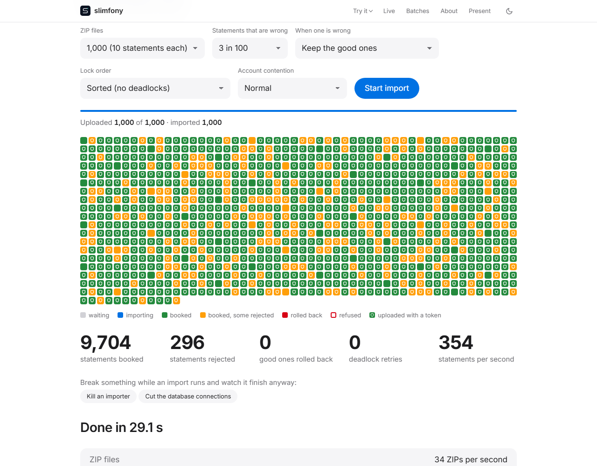

# slimfony demo

A complete service built on [slimfony/core](https://github.com/slimfony/core): PHP 8.4 on FrankenPHP in worker mode, with live numbers read from the running system.

```bash
docker compose up -d --build --wait
```



The picture is a real run of 1,000 ZIPs (10,000 statements). [A recording of the whole run](assets/import.webm) (5 MB).

On Windows, set `BUILDX_BAKE_ENTITLEMENTS_FS=0` before the Docker command, in the same terminal (without it Docker Compose's builder can stop to ask for file system access):

```bat
:: Command Prompt
set BUILDX_BAKE_ENTITLEMENTS_FS=0
docker compose up -d --build --wait
```

```powershell
# PowerShell
$env:BUILDX_BAKE_ENTITLEMENTS_FS = "0"
docker compose up -d --build --wait
```

The page's *Runtime* table shows which version of the demo runs. A plain build shows the latest release from the changelog (`0.5.1`), with `+dev` when the changelog lists changes that are not released yet; to show something else, pass it: `APP_VERSION=my-build docker compose up -d --build --wait`.

| What | Where |
| --- | --- |
| The page | <http://localhost:8080> (HTTPS with a local certificate: <https://localhost:8443>) |
| Grafana (anonymous, read only) | <http://localhost:3000> |

Docker needs about 3 GB of memory for this stack.

**Contents**

- [On the page](#on-the-page)
- [The demo case: importing bank statements](#the-demo-case-importing-bank-statements)
- [What runs](#what-runs)
- [API](#api)
- [Performance](#performance)
- [Start your own service from this repository](#start-your-own-service-from-this-repository)
- [Development](#development)
- [Status](#status)
- [Roadmap](#roadmap)
- [License](#license)

## On the page

- **Import.** Press *Start import*: the server generates up to 1,000 ZIPs of 10 statements each and uploads them to the API (19 in 20 with a token, the rest through the anonymous sandbox). The run lives on the server, so a reload of the page (or a second visitor) joins it instead of losing it. One tile per ZIP shows where it is: waiting, importing, booked, booked with rejected statements, rolled back, refused. A shield marks the uploads that came with a verified token. Numbers, a result card and a live log of the services follow.
- **Chaos.** While an import runs, kill an importer in the middle of a batch or cut the database connections. Every ZIP still ends up booked, or failed with the reason on record; none stays waiting. "Account contention: high" spreads the statements over six accounts, so the importers meet on the same rows and the deadlocks multiply.
- **Tokens and keys.** Send a ZIP with a valid or a broken token and see why it is refused. Rotate the identity provider's signing key and see the API pick up the new one.
- **Send requests.** The browser sends a few thousand requests to the API as fast as it can.
- **Live** (requests per second and latency from Prometheus), **Batches** (the latest ZIPs), **Present** (a big-screen view) and a short guided tour.

## The demo case: importing bank statements

A bank sends its customers' account statements as ZIP files. Each ZIP holds XML files in the ISO 20022 **CAMT.053** format (a reduced version of the schema is in [schema/](schema/)), one statement per file. The service has to take thousands of these in at once and book every statement correctly.

What the demo shows, with a real service and not a toy endpoint:

- **Taking uploads in.** Two ways in: with a token (`/api/imports`, the sender is known and recorded) and as an anonymous sandbox (`/public/drop`, small files only, rate limited). Every broken token is refused for its own reason: expired, forged, wrong audience, missing permission.
- **Booking each statement all or nothing.** A statement, its entries and the balance of its account are written in one transaction. The files are checked against the XSD first, then against the business rules: the opening balance plus the entries must give the closing balance, the account must be one of ours and in the same currency, the entries must lie in the statement period, nothing may be imported twice.
- **Two ways to treat a bad statement.** `partial`: the bad statement is rolled back and recorded, the other nine stay. `strict`: the whole ZIP is one transaction with a savepoint per statement; every mistake is reported, then everything is rolled back, the nine good statements too, and each is accounted for.
- **Many importers at once.** Importers share the work through NATS JetStream. They update the same few accounts, so they run into deadlocks; the database ends one transaction and the core's `Retry` runs it again. The retries are counted and visible.
- **Seeing it work.** Every service exposes metrics, Prometheus scrapes them every two seconds, and the Grafana dashboard and the page show the same numbers.

The statements come from a generator that makes valid files and, on request, files that are wrong in one specific way (a wrong balance, an unknown account, a schema error, and so on), so every rule can be seen doing its job.

## What runs

| Service | Role |
| --- | --- |
| `web` | FrankenPHP with 4 PHP workers, serves the API and the static page |
| `postgres` + `pgbouncer` | database, reached through a transaction pooler |
| `idp` | small identity provider: publishes its keys (JWKS) over HTTPS and hands out demo tokens |
| `relay` | command line process that publishes the outbox rows to NATS JetStream (several can run side by side), and announces batches that were forgotten again (the sweeper) |
| `generator` | command line process that serves the runs the page asks for: it uploads the ZIPs of an import and sends the requests of "Try it" (the page follows the run, so a reload does not stop it) |
| `importer` (4 replicas) | take batches from NATS and book the statements; `docker compose up --scale importer=8` runs more |
| `nats` | JetStream message broker |
| `prometheus` + `grafana` | metrics, scraped every 2 seconds, with a provisioned dashboard |
| `init` | generates random secrets into a volume once; nothing secret is in the repository |

The containers run as a non-root user, with a read-only file system, no capabilities and no new privileges. PHP and Caddy use production settings: no timestamp validation, JIT, no error output, request and header limits.

## API

| Route | Purpose |
| --- | --- |
| `GET /healthz`, `/readyz` | liveness and readiness (database, NATS, Prometheus) |
| `GET /metrics` | Prometheus metrics, bearer token required |
| `GET /api/runtime` | PHP, JIT, server and core versions, uptime, memory |
| `GET /api/status` | state of every dependency |
| `GET /api/stats` | requests per second, p99 and total, read from Prometheus |
| `GET /api/sample.zip?seed=&files=&fault_rate=&fault=` | a ZIP of generated CAMT.053 statements (the same seed gives the same ZIP; some can be made wrong on purpose) |
| `GET /api/batches`, `GET /api/import/summary` | the latest batches, and what the importers have done so far (public) |
| `POST /api/demo-rotate` | the identity provider starts signing with a new key |
| `POST /api/demo-token?kind=…` | a token from the demo identity provider: `valid`, `expired`, `bad_signature`, `wrong_audience` or `missing_scope` |
| `POST /api/imports?mode=partial\|strict` | upload a ZIP of statements; needs a valid token with scope `import:write` |
| `POST /public/drop` | the same upload without a token: anonymous sandbox with tighter limits |
| `GET /api/batches/{id}` | state of an upload; needs scope `import:read` |

Every route needs a verified token unless it is marked public (deny by default); a request for an unknown path gets 401 as well, so a stranger cannot map the API. An accepted upload is stored together with an outbox row in one transaction; the batch records whether it came with a token (`jwt`), who sent it and which key vouched for it, or came from the sandbox (`public`). The demo identity provider gives tokens to anybody: that is the demo, a real provider authenticates first.

## Performance

Measured with k6 on one laptop-class machine (i5-14400, everything in Docker), so read the ratios rather than the absolute numbers. Method, raw results and the machine are in [benchmarks/](benchmarks/README.md).

| What | Result |
| --- | --- |
| `GET /healthz` | 15,000 requests per second without an error or a dropped request (p95 7 ms) |
| `GET /api/batches/{id}` (verified token, database read) | about 12,400 requests per second with 16 PHP workers (6,500 with 4: workers that wait for the database are the limit, not the CPU) |
| Import of 1,000 ZIPs (10,000 statements) | 11.5 s with eight importers, about 35 ms per ZIP with one; rows are locked in a fixed order, so there is no deadlock and every importer added helps (before: 67 s with eight, because of the deadlocks) |

**Is that good?** Yes, and for PHP very good. The same application on the same machine and server, started the classic way (a fresh boot for every request), saturates at about 1,300 requests per second and needs 3.6 ms per request; in worker mode it answers 15,000 and more at 0.5 ms. The import books about 700 statements per second with eight importers, each statement in its own transaction, checked against a schema and business rules. A bulk load would be faster, but it would give up the per-statement rollback that the import is about. It is one laptop-class machine, so read the ratios, not the absolute numbers.

The benchmarks folder keeps every run, before and after each change.
## Start your own service from this repository

The code is meant to be copied: the structure (a composition root per process, the compiled container, the Dockerfile, the compose file, the CI) is the part worth keeping, the demo's import is the example.

```bash
php scripts/rename.php "Acme\Orders" acme/orders   # your namespace and your package name
composer install && composer dump-autoload
composer ci
```

On GitHub, **Use this template** creates a repository with this content and none of its history. What is left to you: remove what you do not need (the import, the identity provider, the chaos switches, the page), and rename the services in `compose.yaml`, the `Dockerfile` and `k8s/`. Keep `tests/ArchitectureTest.php` and the CI: they hold the code to the rules of the core.

> **A smaller starting point is planned:** `slimfony/starter-template`, a template repository without the demo's import, identity provider, chaos switches and page, with only the structure every service needs (the composition root, the compiled container, health checks and metrics, the Dockerfile, the compose file, the CI and the architecture test). Until it exists, start from this repository as described above.
## Development

```bash
composer install
composer ci          # tests, PHPStan (max), code style
bash scripts/e2e.sh  # starts the stack and checks it (including the chaos scenario)
bash scripts/chaos.sh  # on a running stack: kill importers, cut connections, lose a message; nothing may be lost

cd e2e && npm ci && npx playwright install chromium
npx playwright test    # the page in a real browser, against the running stack
```

## Status

Version 0.6.0 (see [CHANGELOG.md](CHANGELOG.md)), pre-1.0. The stack, the API, authentication with key rotation, both upload paths, the outbox relay with its sweeper, the importers (`partial` and `strict` mode, ordered locking), the chaos switches, the page with the live import view, the benchmarks, the Kubernetes manifests and the template script work, and are exercised by the tests, by `scripts/e2e.sh` and by a browser test in CI.

The numbers on the page and in the benchmarks come from one laptop-class machine running everything in Docker. They show how the pieces behave and how a change moves them; they are not a capacity figure for a cluster.

## Roadmap

Next:

1. **More runs of the benchmark**: a second machine, more importers than eight, the importers on their own cores.
2. **The relay on its own**: how many outbox messages per second it publishes, and whether publishing several at once (not waiting for each acknowledgement) is worth it.
3. **Why a pull from the broker waits about 40 ms.** Pulling several messages at once avoids it; the cause (the NATS client, or the connection) is not known yet.
4. **Two things not measured yet**: whether storing the ZIP as hex (twice its size) and parsing the XML with a DOM matter at all next to the database.
5. **A smaller starting point**: a `slimfony/starter-template` repository, as described above.

## License

MIT
